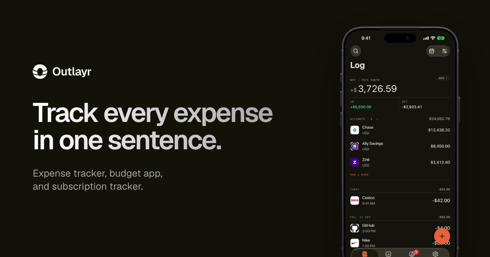

# Outlayr

Outlayr is an open source mobile expense tracker, budget app, and subscription tracker. Log a purchase by typing one sentence, saying it, or scanning the receipt. The ledger lives on the phone; sign-in, sync and server features are optional. On Android, coming soon to the App Store.

<a href="https://play.google.com/store/apps/details?id=com.tryoutlayr.app"></a>

[tryoutlayr.com](https://tryoutlayr.com)



## Features

- One-sentence entry, voice entry and receipt scanning
- Category or overall budgets with carry-over and a projection of where the month ends
- Savings goals, accounts, transfers and 165 currencies, converted at the rate from the day of each purchase
- Subscriptions and paychecks that log themselves, with a reminder before each charge
- Insights, Home and Lock Screen widgets, Face ID lock, CSV import and export
- Works offline, in English and Spanish

## Layout

```
apps/
  native/        Expo + React Native app, iOS and Android
  web/           tryoutlayr.com, TanStack Start
  screenshots/   App Store screenshot editor
  clips/         Remotion videos for the site, socials and in-app loops
packages/
  backend/       Convex: auth, sync, exchange rates
  money/         Money math shared by app and backend
  env/           Typed env for each app
  config/        Shared tsconfig and lint presets
```

## Getting started

Requires Node 24 and [Vite+](https://viteplus.dev) (`vp`), which manages pnpm and runs tasks, lint and format:

```bash
curl -fsSL https://vite.plus | bash
```

The app icons come from Hugeicons Pro, a paid private registry. With a license, put the token in your user-level config, never in the repo `.npmrc`:

```bash
vp pm config set --global "//npm.hugeicons.com/:_authToken" "<token>"
vp install
```

Run the app on the iOS simulator or an Android emulator:

```bash
vp run --filter @outlayr/native ios
vp run --filter @outlayr/native android
```

The app runs without a backend. To work on sync, sign-in or exchange rates, start a local Convex deployment and copy its URLs into `apps/native/.env` (see `apps/native/.env.example`):

```bash
vp run dev:setup
vp run dev:server
```

### Without a Hugeicons Pro license

Skip the token. The Pro packages are optional, so pnpm skips them once the flag below keeps its release-age check off their registry. `OUTLAYR_FREE_ICONS=1` then draws every icon from the free Hugeicons set, with a dashed circle for any name the free set lacks:

```bash
vp install -- '--config.minimum-release-age-exclude=@hugeicons-pro/*'
OUTLAYR_FREE_ICONS=1 vp run --filter @outlayr/native ios
OUTLAYR_FREE_ICONS=1 vp run --filter @outlayr/native android
```

Type-checking, a few test suites and `gen:icons` still need the Pro packages.

## Scripts

- `vp check`: lint and format check (`vp check --fix` applies fixes)
- `vp run check-types`: type-check every package
- `vp run test`: run every package's tests

Architecture notes and runbooks are in [docs](./docs/README.md).

## License

GPL-3.0, see [LICENSE](./LICENSE). `apps/native` began as a modified version of [Dime](https://github.com/rafsoh/dimeApp) by [Rafael Soh](https://github.com/rafsoh) and contributors, also GPL-3.0. Thanks for such a solid foundation.

`packages/backend` is AGPL-3.0, see [packages/backend/LICENSE](./packages/backend/LICENSE). `apps/native/modules/glow` vendors an MIT Expo module, see its [LICENSE](./apps/native/modules/glow/LICENSE).

The NumberFlow Swift package from the SwiftUI era now lives at [danestves/numberflow](https://github.com/danestves/numberflow).
