# Notifications panel proof

Local Convex, seeded proof users on Pro, time zone America/Caracas, captured 2026-11-19. Desktop 1440x960, mobile 390x844.

## Notifications · Panel · Default (`gOv9yXP6oe`)

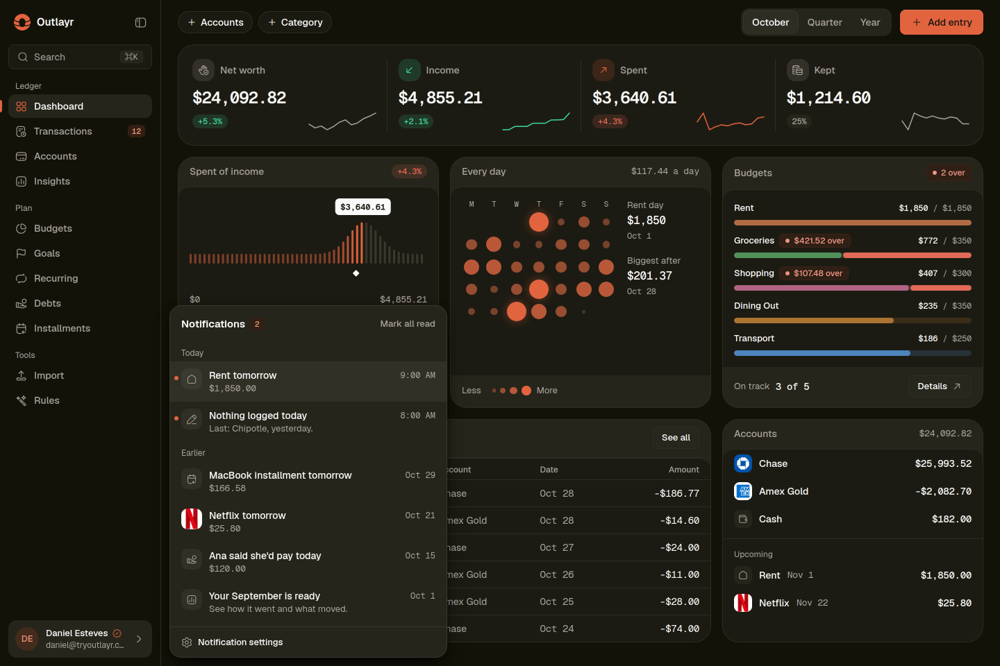

- 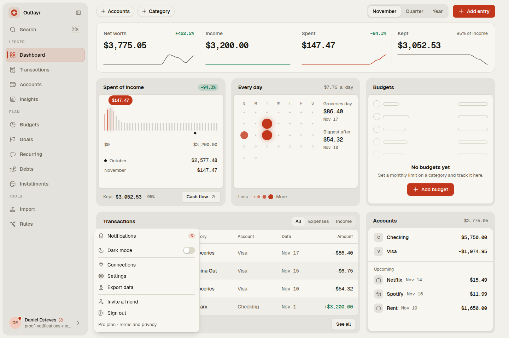 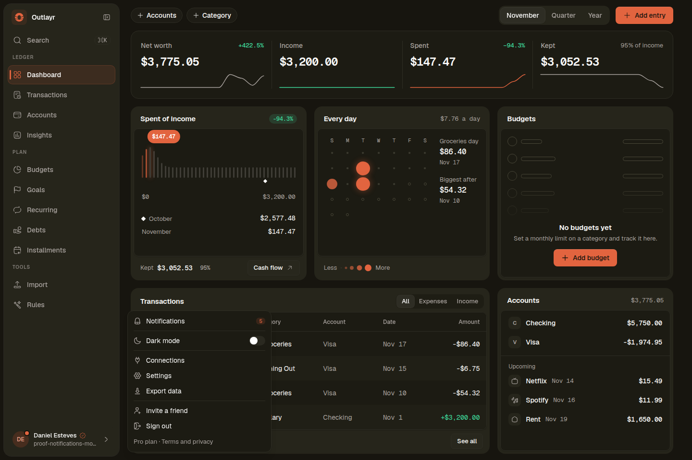
  The panel opens from a Notifications item in the user card menu; the canvas opens it straight from the card.
-  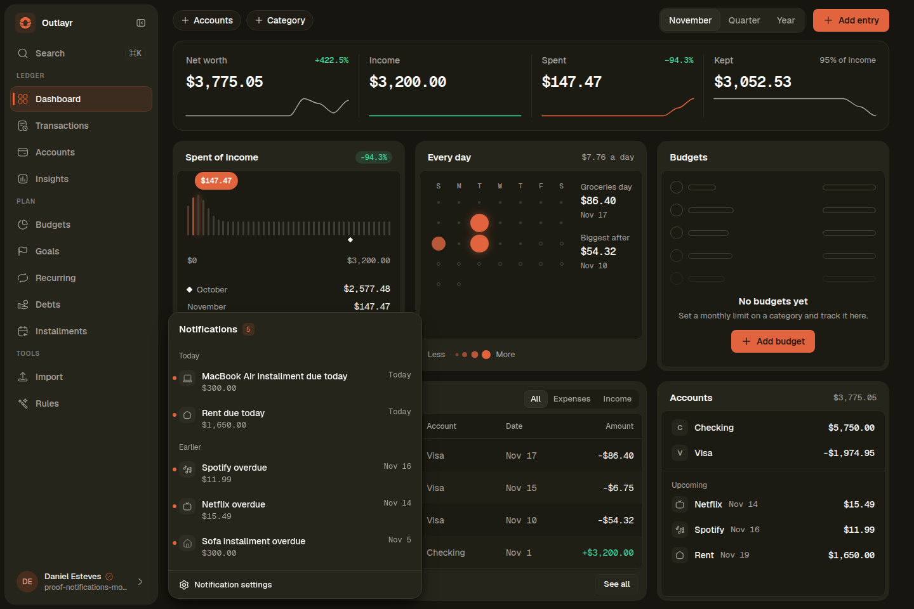
  Panel sits about 20px further right; no "Mark all read" (opening marks read); times read "Today" or "Nov 16", not clock times; 26px glyph tiles instead of 30px brand logos; no first-row highlight; only due or late recurring charges and installments, so the canvas's daily nudge, IOU and recap rows never appear; copy says "due today" or "overdue", not "tomorrow".
- 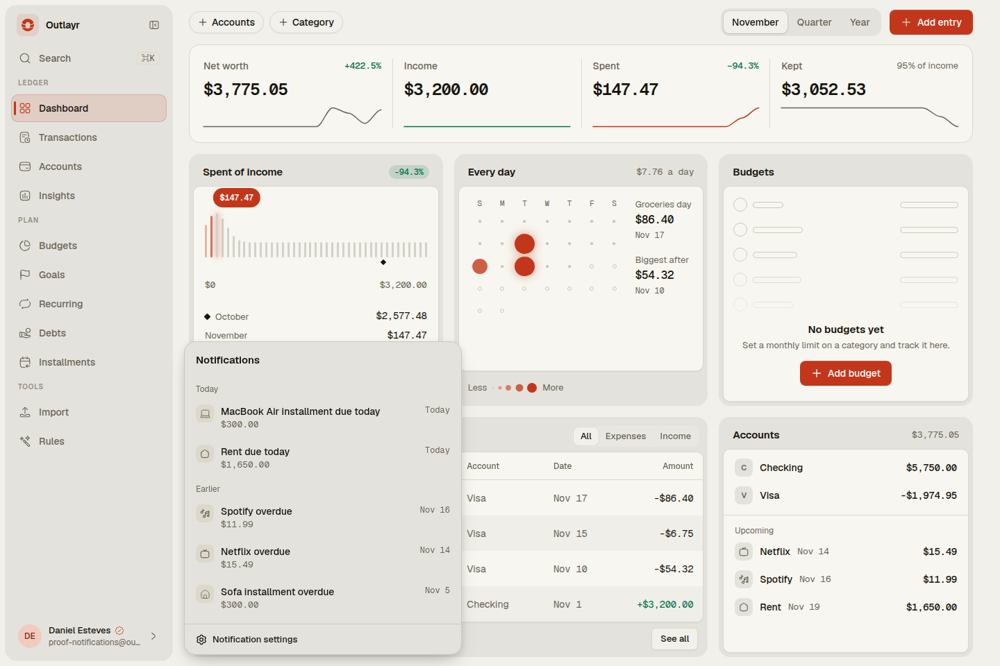 
  Same rows after a reload and second open: no chip, no dots, no card dot. The canvas has no read state.
- 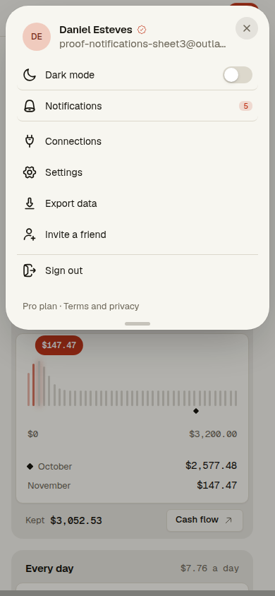 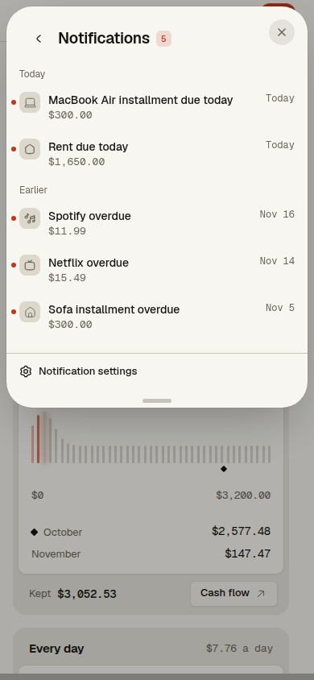 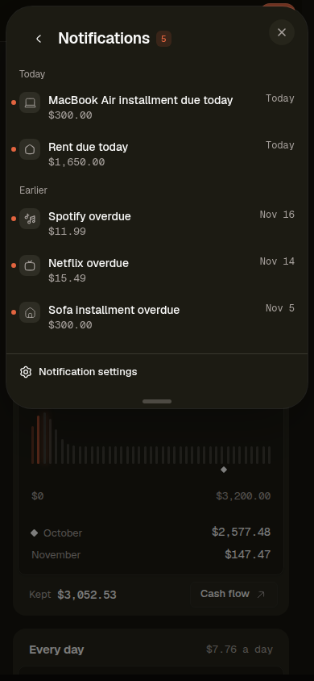
  No mobile frame on the canvas; the list opens from the account sheet's Notifications row, with a back button.
- 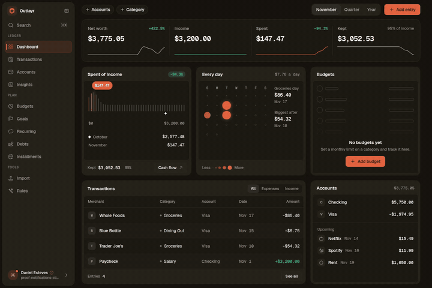 ([mp4](open-close.mp4))
  Open, close, reopen: the chip and card dot are gone on the second open.

## Notifications · Panel · Empty (`y4t1J6Xdsr`)

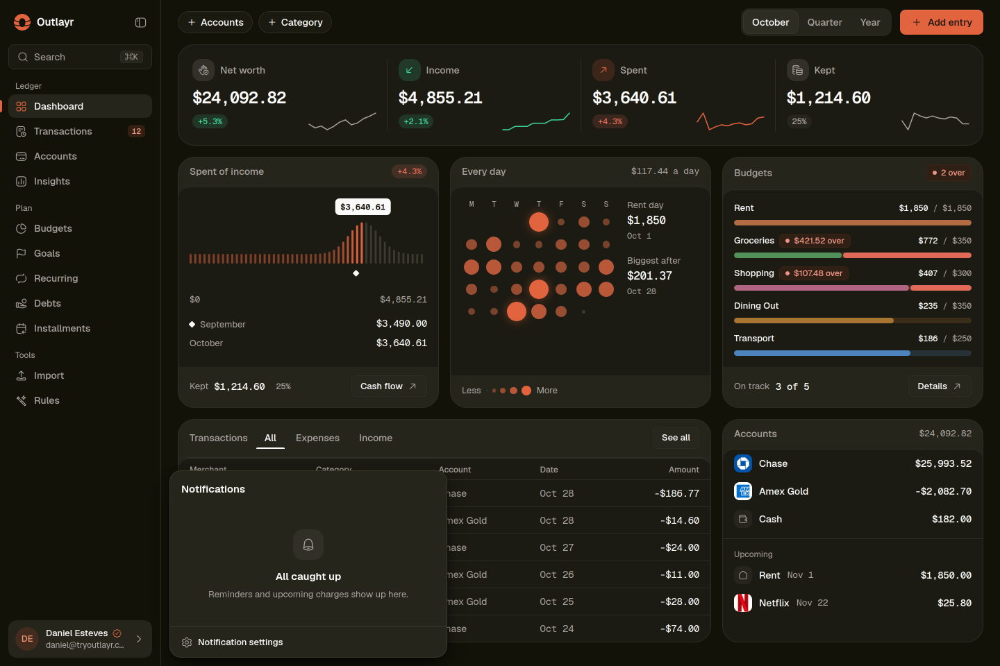

- 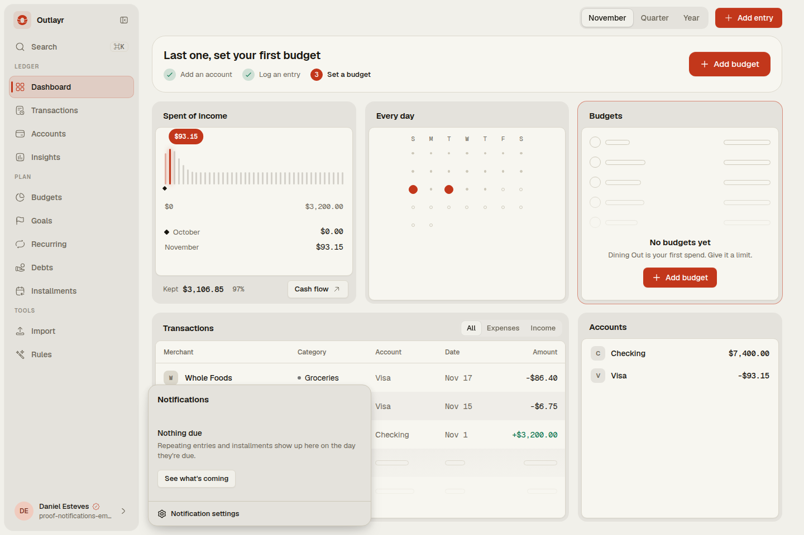 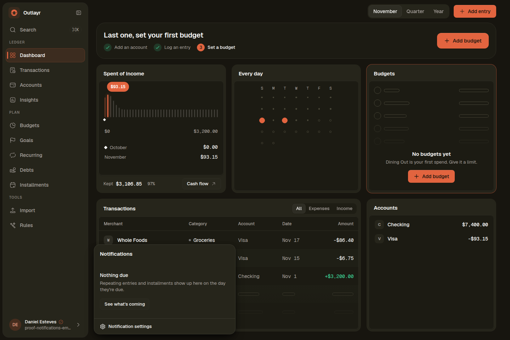
  Left aligned "Nothing due" with a "See what's coming" button, as Daniel asked (a message and the next action, no icon art); the canvas centers a bell tile over "All caught up" with no button.
- 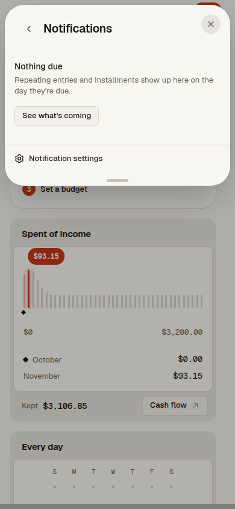
  Same empty copy in the sheet; the settings row sits in the sheet footer, clear of the grabber.

Not captured: the loading skeleton. The full ledger landed before the menu could open in five tries.
