# Transactions review badge

Real app captures from a local stack (web dev server and a local Convex copy) with 11 November entries. Count state: 7 flagged for review. Zero state: the same entries, none flagged. Canvas frames are from Doop canvas `qglUCf5arb`.

## Desktop sidebar, 1440x960

| Canvas | App, count | App, zero |
| --- | --- | --- |
| 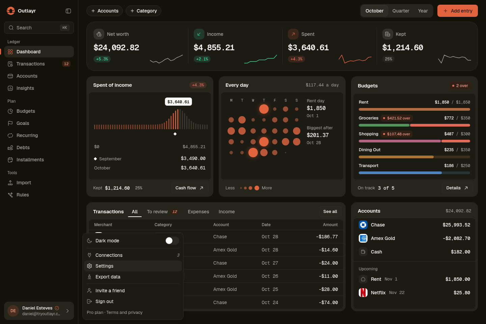 |  | 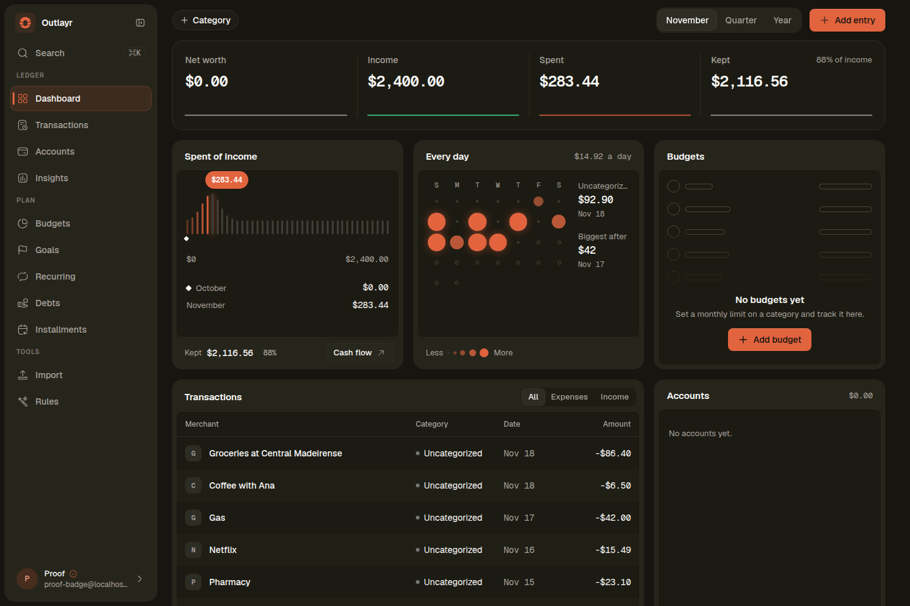 |
| 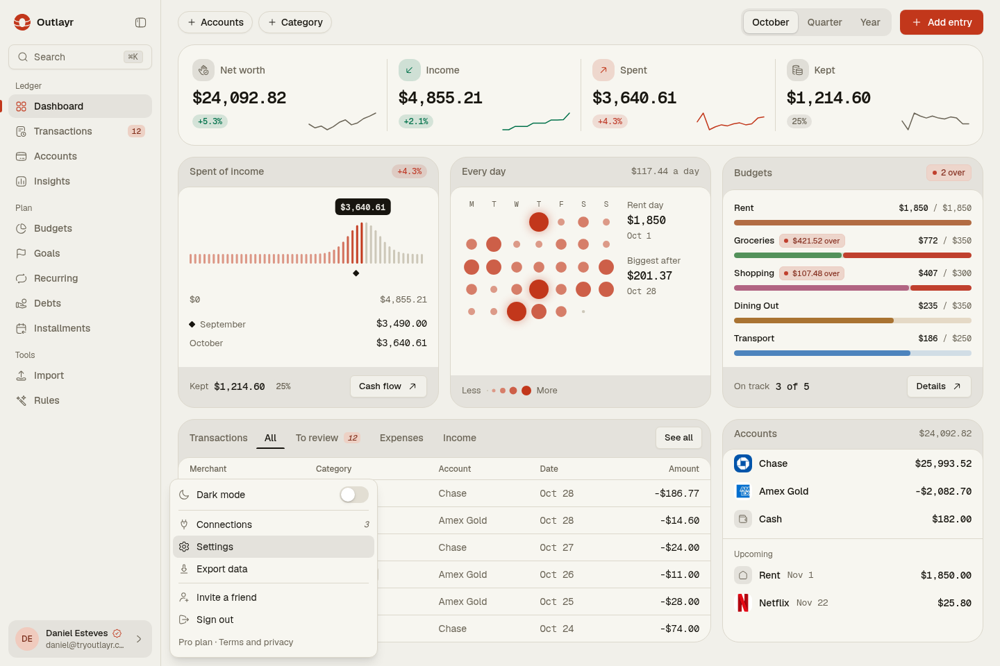 | 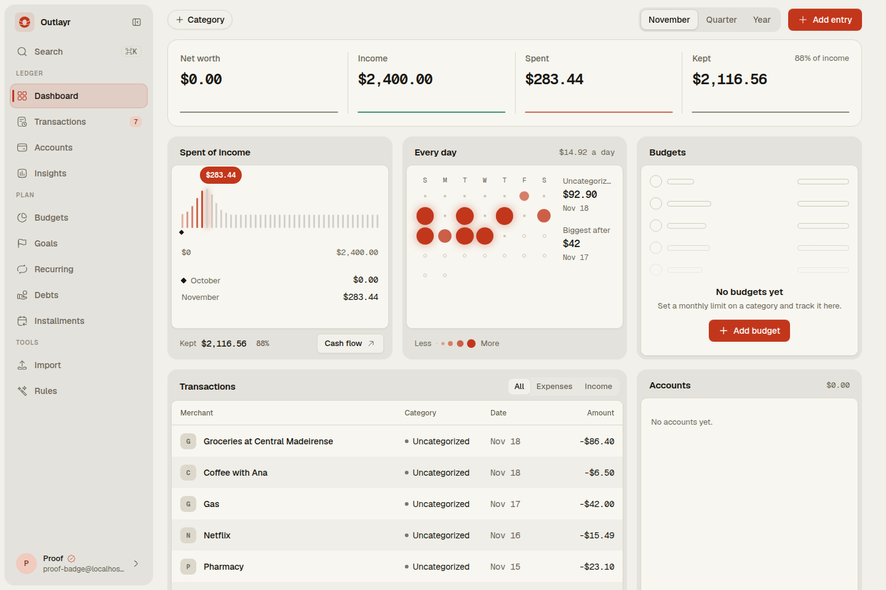 | 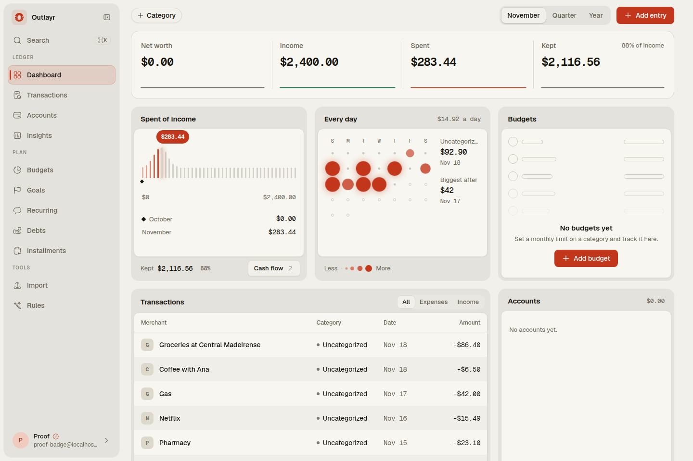 |

Canvas: `FGdhKexm6A` "Dashboard · User menu open" (dark), `KohDfR9VkA` "User menu · Light mode" (light). The badge matches the canvas in size, type, radius and colour. Still different: the shell around it (floating sidebar panel, uppercase group labels, 40px rows) comes from phase 2, and the canvas frames have the user menu open.

## Folded rail, 1440x960

| Canvas | App, count |
| --- | --- |
| 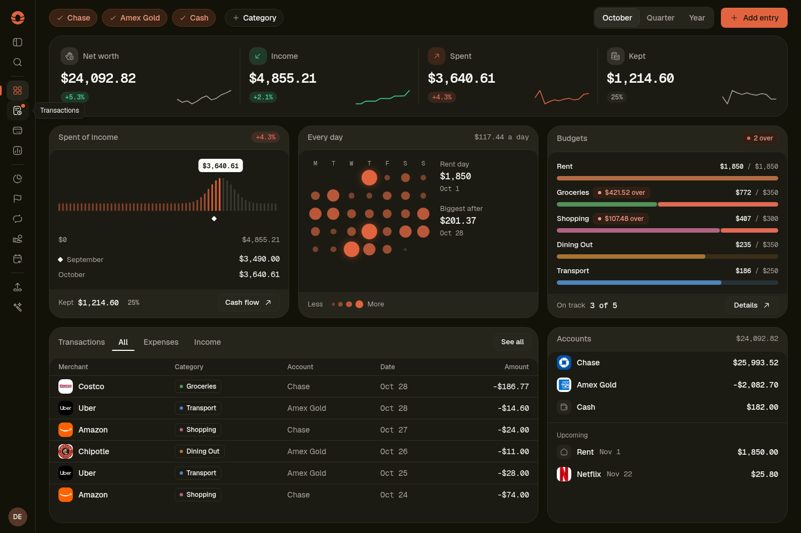 | 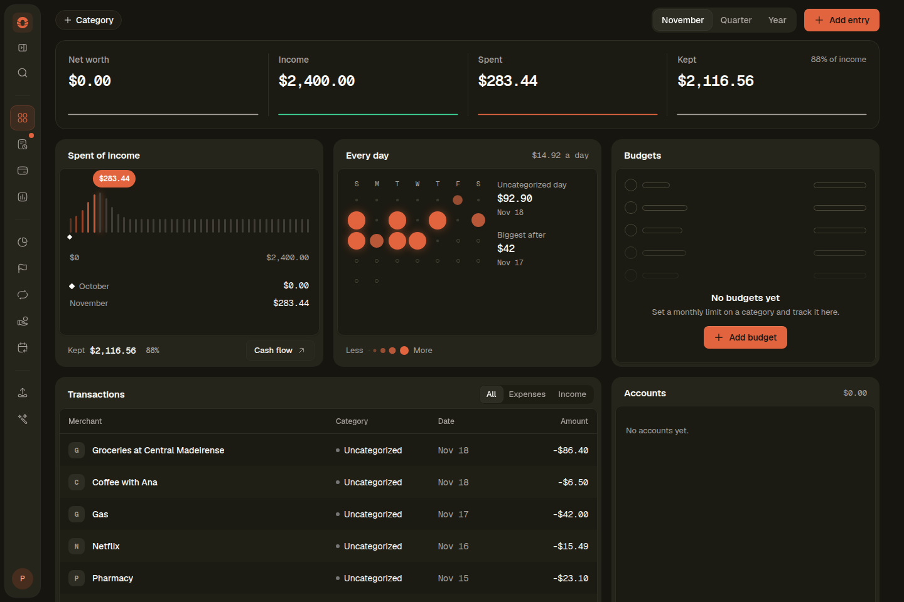 |

Canvas: `1sL-ZdjGTr`. Both fold the count into a tint dot on the Transactions icon. Still different: the canvas shows the row's tooltip.

## Mobile drawer, 390x844

| Canvas | App, count | App, zero |
| --- | --- | --- |
| 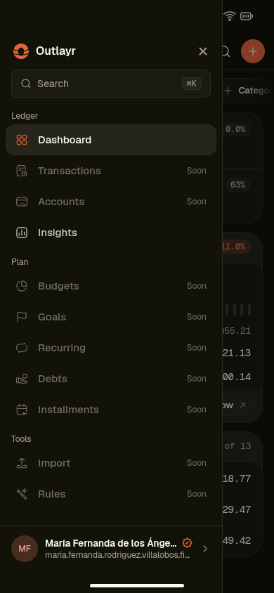 | 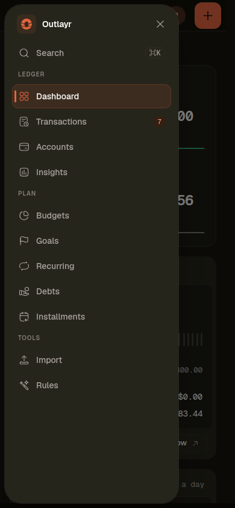 |  |
| 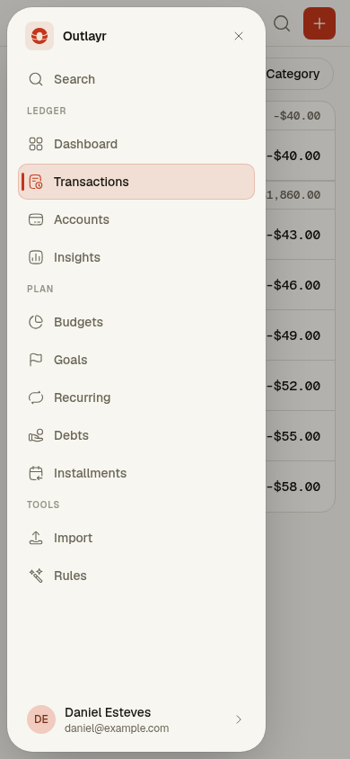 | 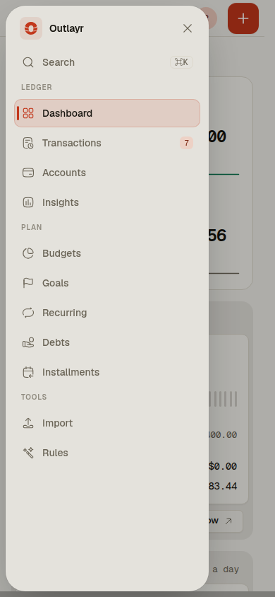 | 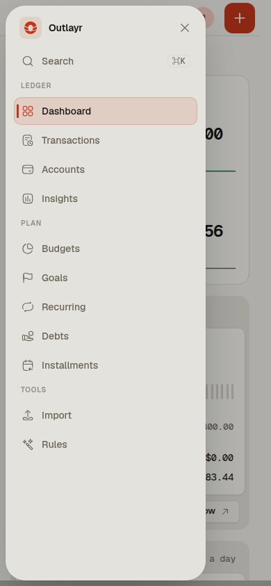 |

Canvas: `4hJ1rm5DTF` (dark), `uUFZQ_gW_d` "Mobile · Drawer · Open · Light". Still different: the dark frame is stale and labels Transactions "Soon"; the light frame sits on the Transactions route with no count; the canvas drawer has an account row at the bottom that the app's drawer doesn't.
